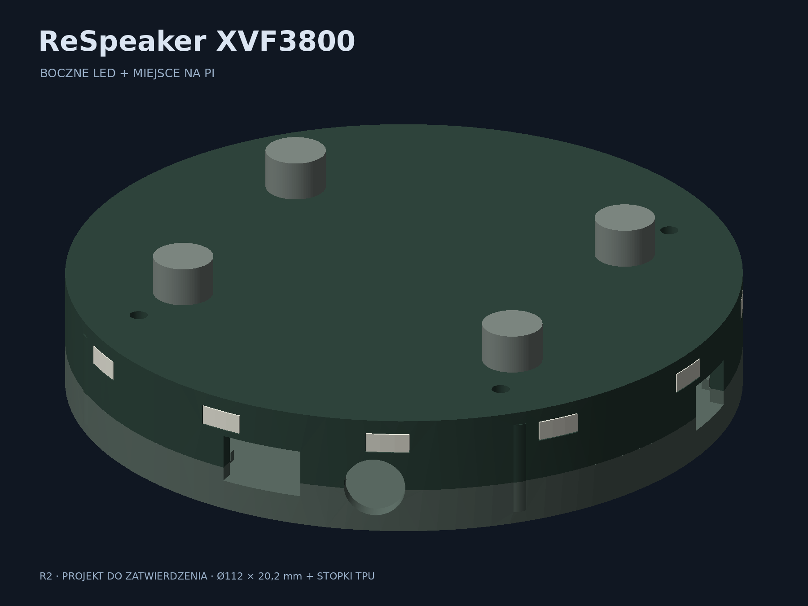
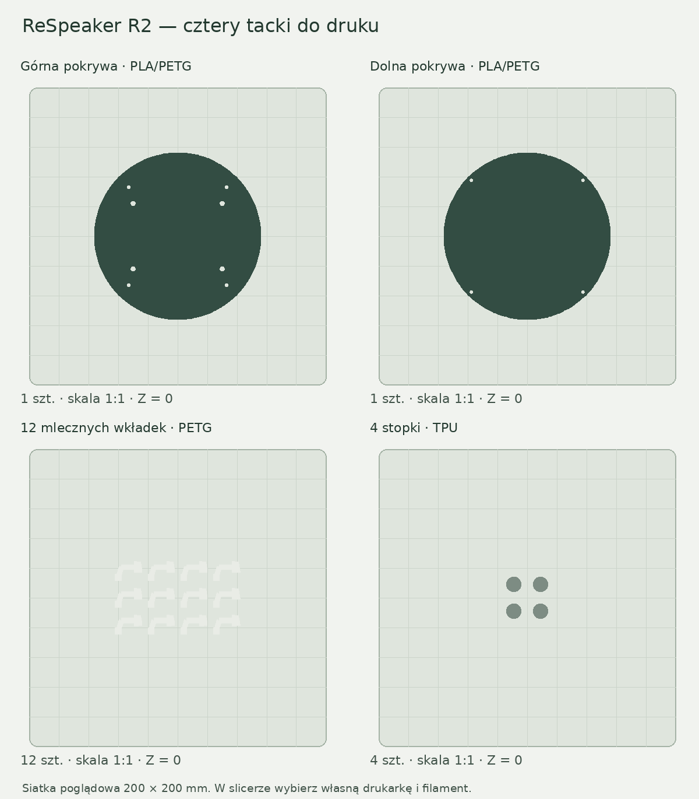

# ReSpeaker XVF3800 — obudowa R2

Obudowa standardowej płytki Seeed Ø100 mm / 12 LED: góra, dół, boczne mleczne prowadnice światła oraz cztery stopki TPU pod Raspberry Pi.

**Status: prototyp do przymiarki.** Model v1.1 użytkownika wymaga fizycznego potwierdzenia; jasność prowadnic i akustyka nie były jeszcze testowane.

- [Podgląd 3D w przeglądarce](https://stapowiczmarcin-sys.github.io/projects/respeaker-xvf3800/preview/)
- [Cztery tacki 3MF + STL](downloads/RESPEAKER_R2_TACKI_3MF_STL.zip)
- [Modele części STL + STEP](downloads/RESPEAKER_XVF3800_R2_PROTOTYP.zip)
- [Instrukcja druku i montażu](docs/README_PL.md)
- [Kontrola geometrii obudowy](docs/verification.json) · [Kontrola tacek](docs/kontrola-tacek.json)
- [Sumy SHA-256 paczek](downloads/SHA256SUMS.txt)

## Tacki

| Tacka | Zawartość | Materiał |
| --- | --- | --- |
| 01 | Górna pokrywa, 1 szt. | PLA/PETG |
| 02 | Dolna pokrywa, 1 szt. | PLA/PETG |
| 03 | Mleczne prowadnice LED, 12 szt. | Półprzezroczysty mleczny PETG |
| 04 | Stopki pod Pi, 4 szt. | TPU |

Tacki 3MF zawierają geometrię bez profilu drukarki i bez G-code. Importuj wybrany 3MF albo odpowiadający mu STL, zachowując skalę 100%. Wybierz drukarkę, filament i podpory w swoim slicerze. Najpierw wydrukuj jedną wkładkę i dołączoną próbkę szczeliny.

## Układ folderów

- `downloads/` — paczki do pobrania i sumy kontrolne.
- `docs/` — instrukcja i raporty CAD.
- `preview/` — samodzielny podgląd 3D, modele oraz biblioteka Three.js z licencją.
- `assets/` — rzeczywiste podglądy geometrii CAD i układu tacek.

[Wszystkie projekty](../README.md) · [Portfolio](../../README.md)
